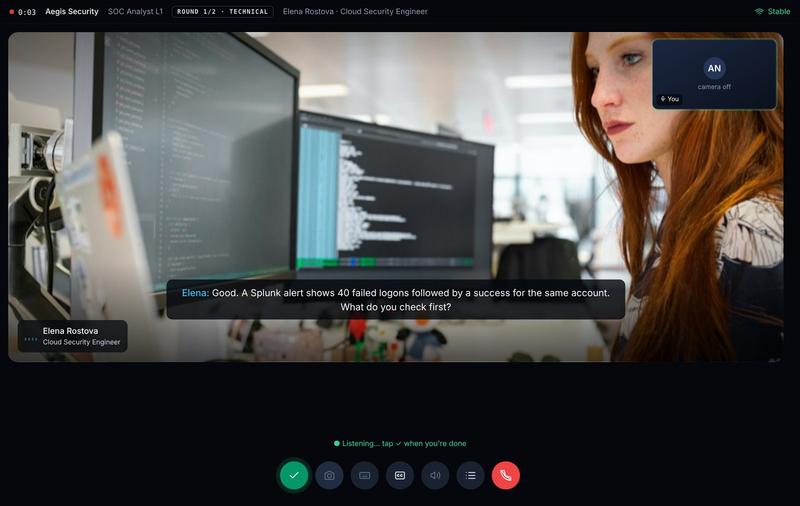
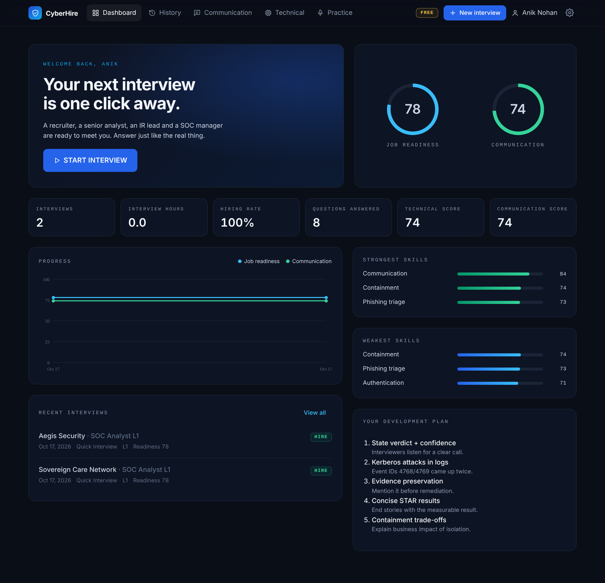
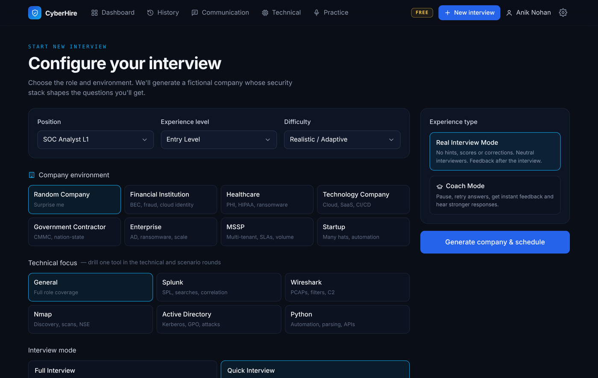
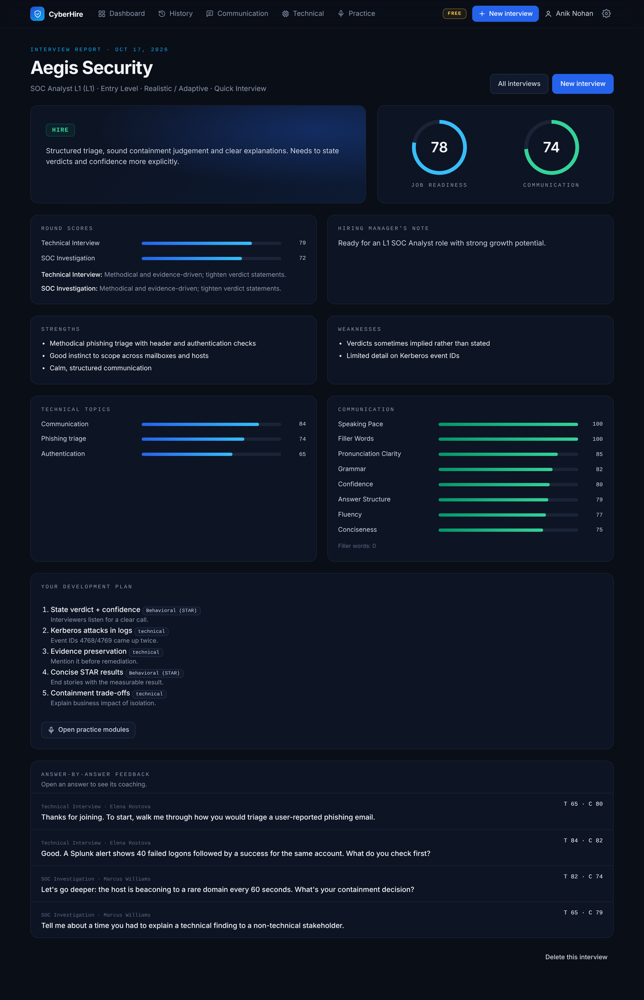
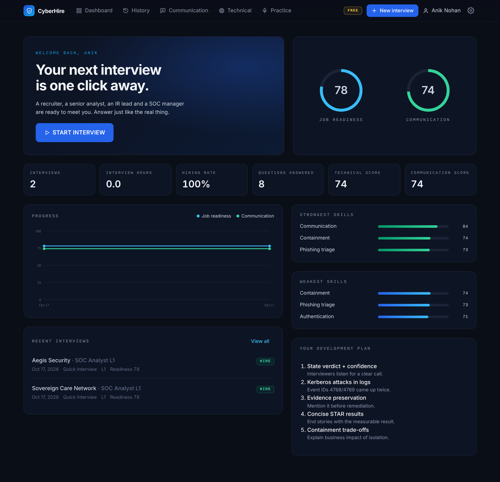
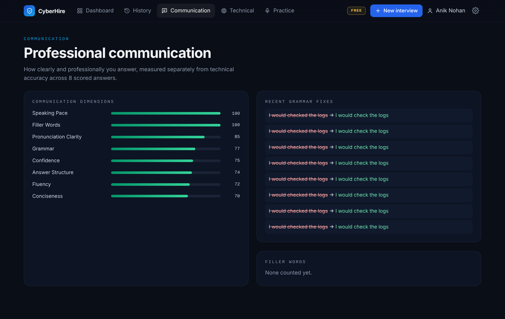
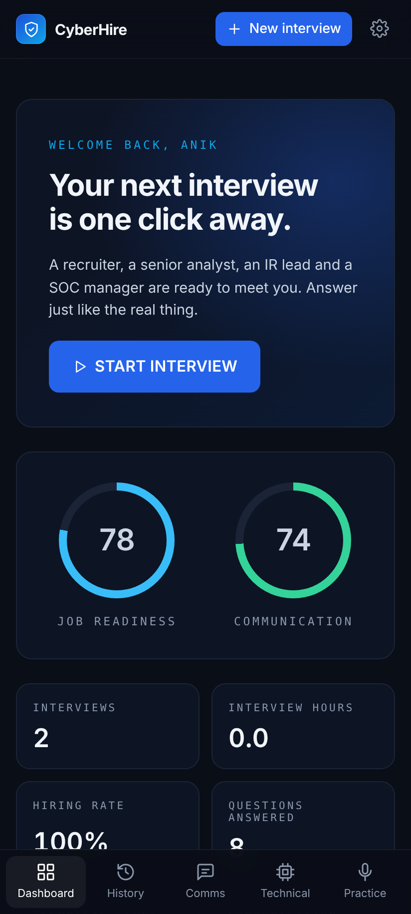
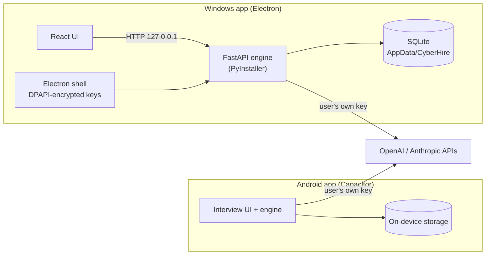

# CyberHire: AI Cybersecurity Interview Simulator


CyberHire is a free, offline-first desktop and mobile app for practising **SOC Analyst and cybersecurity job interviews** with realistic AI interviewers. It runs a full hiring loop: recruiter screen, technical interview, live SOC investigation and hiring-manager round. Interviewers speak their questions, you answer out loud or by typing, and every answer is scored on technical accuracy and communication. You finish with a hire / no-hire decision and a personal development plan.

The app runs **entirely on the user's own device**. There is no CyberHire server, account or subscription. Users bring their own OpenAI or Anthropic API key, and their interviews, recordings and reports never leave their computer or phone.

> **Download:** [Latest release](https://github.com/aniknohan/cyberhire-windows-ai-lab/releases) has the Windows installer (`.exe`), a portable Windows build, and the Android app (`.apk`).



## Why I Built This

Entry-level SOC candidates rarely get to rehearse a real interview loop. Technical questions are only half of it: hiring teams also listen for structured triage, clear verdicts, calm escalation and professional communication. CyberHire recreates that pressure. Candidates face different interviewers, follow-ups that dig into their own answers, and an alert-investigation round with evidence on screen. The feedback separates *what* they knew from *how well they explained it*.

## Features

- **Full interview loop:** HR screening → Technical → SOC Investigation → Hiring Manager, with 8 interviewer personas who each have their own voice, personality and focus area.
- **Adaptive questioning:** the interviewer chooses follow-ups based on your previous answer, digs deeper on vague claims, and moves on when you've shown competence.
- **Live SOC investigation round:** realistic alert scenarios with log, process-tree and email evidence shown during the call.
- **Voice interview:** spoken questions (OpenAI TTS) and spoken answers (Whisper), with automatic end-of-answer detection, captions and a camera self-view.
- **Two experience modes:** *Real Interview* (neutral, no hints) and *Coach* (pause, retry, instant feedback and a model answer).
- **Technical focus tracks:** General, Splunk, Wireshark, Nmap, Active Directory or Python.
- **Company environments:** fictional Financial, Healthcare, MSSP, Government Contractor, Enterprise, Startup and Technology companies, each with its own security stack.
- **Scoring and reports:** technical score, communication score (grammar, fluency, structure, confidence, conciseness), speaking pace, filler words, pronunciation clarity, STAR coverage, a hiring decision and a 5-step development plan.
- **Practice modules:** six drills: Tell me about yourself, behavioural STAR, technical explanation, explaining to a non-technical audience, pronunciation and rapid-fire questions.
- **Progress tracking:** dashboard trends, strongest and weakest skills, and full interview history.
- **Privacy by design:** local database, API keys encrypted with Windows DPAPI on desktop, no telemetry.

## Screenshots

| Dashboard | Interview setup |
|---|---|
|  |  |

| Interview report | Technical skills |
|---|---|
|  |  |

| Communication analysis | Android (phone) |
|---|---|
|  |  |

## Tools & Technologies

- **Python / FastAPI:** interview engine, scoring pipeline and REST API (Windows).
- **React + TypeScript + Vite + Tailwind:** desktop user interface.
- **Electron:** Windows desktop shell, settings window, camera/mic permissions, and launching the bundled engine.
- **PyInstaller:** packages the Python engine into a single executable inside the app.
- **SQLite:** embedded local database behind a MongoDB-compatible async layer (`backend/lib/localdb.py`).
- **Capacitor (Android WebView):** standalone Android app with on-device storage.
- **OpenAI API:** GPT-5.2 (with a GPT-4.1 fallback) for interviewing and scoring, Whisper for speech recognition, and `gpt-4o-mini-tts` for interviewer voices.
- **Anthropic API (optional):** Claude Sonnet 4.5 as the interviewer and scoring model.
- **Web Audio + MediaRecorder:** microphone capture and voice-activity detection.
- **GitHub Actions:** automated Windows (`.exe`) and Android (`.apk`) builds and releases.

## Architecture



Read more in [Architecture](docs/01-architecture.md).

## Interview Workflow

1. **Configure:** choose a position (SOC Analyst L1–L3, Incident Response, Threat Detection and more), experience level, difficulty, company environment, technical focus and mode.
2. **Company generation:** CyberHire creates a fictional employer with a security stack, an interview panel and a schedule.
3. **Lobby:** check your camera, microphone and speakers, like before a real video call.
4. **Live rounds:** each interviewer asks seeded questions from the question bank and adapts follow-ups to your answers.
5. **Investigation:** the SOC round presents an alert with evidence; you triage, scope, contain and explain.
6. **Scoring:** each answer is scored on technical accuracy and communication, with speech metrics from the audio.
7. **Hiring decision:** a hiring manager-style verdict with strengths, weaknesses and a development plan.
8. **Practice:** targeted drills feed back into your dashboard progress.

## Question Bank

| Source | Questions |
|---|---|
| Core interview bank (behavioural, SOC fundamentals, scenarios) | 223 |
| SOC Analyst 200 | 153 |
| Tools 200 (Splunk, Wireshark, Nmap, Active Directory) | 168 |
| Python for Cybersecurity 100 | 94 |
| **Total SOC bank** (after removing 96 duplicates) | **638** |

Each question carries the expected concepts it is scored against, follow-ups the interviewer can use, a level (L1/L2/L3), a round and a category. See [Question Bank](docs/04-question-bank.md).

## Repository Structure

```text
cyberhire-windows-ai-lab/
├── README.md
├── LICENSE
├── backend/                  # FastAPI interview engine (Python)
│   ├── lib/                  # interview engine, scoring, LLM + voice clients, local DB
│   ├── routers/              # REST API: interviews, practice, stats, content
│   └── data/                 # question banks + duplicate-removal list
├── frontend/                 # React + TypeScript user interface
├── electron/                 # Windows shell, settings window, permissions
├── android-app/              # Standalone Android app (Capacitor)
├── docs/                     # Project documentation + screenshots
├── scripts/                  # Build helpers
├── .github/workflows/        # Windows + Android CI builds
└── build-windows.bat         # Local Windows build
```

## Project Documentation

1. [Architecture](docs/01-architecture.md): how the Windows and Android apps are built and how data flows.
2. [Interview Engine](docs/02-interview-engine.md): rounds, personas, adaptive questioning and investigation scenarios.
3. [Scoring Methodology](docs/03-scoring-methodology.md): technical and communication scoring, speech metrics and the hiring decision.
4. [Question Bank](docs/04-question-bank.md): sources, structure and how duplicates were removed.
5. [Privacy & Security](docs/05-privacy-and-security.md): bring-your-own-key model, key storage and data handling.
6. [Build & Release](docs/06-build-and-release.md): CI pipelines for the `.exe` and `.apk`.

## Getting Started

CyberHire is **free**. You only need your own AI key and pay the AI company directly for what you use, roughly $0.05–$0.20 per full voice interview.

**1. Get an API key**
- **OpenAI (recommended, enables every feature):** [platform.openai.com](https://platform.openai.com) → Settings → Billing → add credit (about $5 goes a long way) → API keys → Create new secret key. A ChatGPT Plus subscription does not include API credit.
- **Anthropic (optional):** [console.anthropic.com](https://console.anthropic.com/settings/keys). Interviews and scoring then run on Claude; voice features still need an OpenAI key.

**2. Install**

| Device | File from [Releases](https://github.com/aniknohan/cyberhire-windows-ai-lab/releases) | Notes |
|---|---|---|
| Windows | `CyberHire-Setup-<version>.exe` | If Windows SmartScreen appears, click **More info → Run anyway** (the app isn't code-signed). |
| Windows, no install | `CyberHire-Portable-<version>.exe` | Runs from any folder or USB drive. |
| Android | `CyberHire-Android.apk` | Allow installs from your browser or Files app, then tap **Install anyway** if Play Protect asks. |

**3. First start:** paste your key in Settings, tap **Test**, then **Save**. Allow the camera and microphone, then start an interview.

## Skills Demonstrated

- **SOC domain modelling:** encoded analyst-level expectations (L1–L3), triage methodology, containment judgement and MITRE ATT&CK-aligned scenarios into a question bank and scoring rubric.
- **Applied AI engineering:** multi-provider LLM orchestration with fallback, structured JSON outputs, and prompt design for adaptive interviewers and consistent graders.
- **Speech processing:** Whisper transcription, voice-activity detection, speaking-pace and clarity metrics derived from token log-probabilities.
- **Full-stack development:** FastAPI backend, React/TypeScript frontend, Electron desktop shell, and an Android app.
- **Offline-first architecture:** replaced a hosted MongoDB/cloud stack with an embedded SQLite store and a self-contained engine.
- **Security engineering:** OS-level key encryption (DPAPI), sandboxed renderer processes, context isolation, and no telemetry or third-party data sharing.
- **DevOps:** GitHub Actions pipelines that build, smoke-test and publish Windows installers and Android APKs.
- **Data quality:** merged four question sources and removed 96 duplicate questions with a verified one-to-one mapping.

## Roadmap

- Google Play release
- More investigation scenarios (cloud identity, ransomware, insider threat)
- Exportable PDF interview reports
- Offline speech recognition option

---

## Disclaimer

CyberHire is a practice and educational tool. Companies, interviewers and scenarios are fictional. Scores are AI-generated guidance, not a guarantee of hiring outcomes. API usage is billed by OpenAI / Anthropic to the key owner.

---

## Author

**Anik Nohan**

CyberHire was designed and built to help aspiring SOC analysts prepare for real interviews, and to demonstrate practical skills in:

- Security operations and SOC interview methodology
- Applied AI and LLM application design
- Speech-to-text and voice interface engineering
- Full-stack, desktop and mobile development
- Secure, privacy-first software design
- CI/CD and release engineering

Also see my **[Phishing Email Investigation SOC Portfolio](https://github.com/aniknohan/phishing-email-investigation-soc-portfolio)**.

### Tools Used

`Python` • `FastAPI` • `React` • `TypeScript` • `Electron` • `Capacitor` • `SQLite` • `OpenAI API` • `Anthropic API` • `Whisper` • `GitHub Actions`

## License

Released under the [MIT License](LICENSE).
