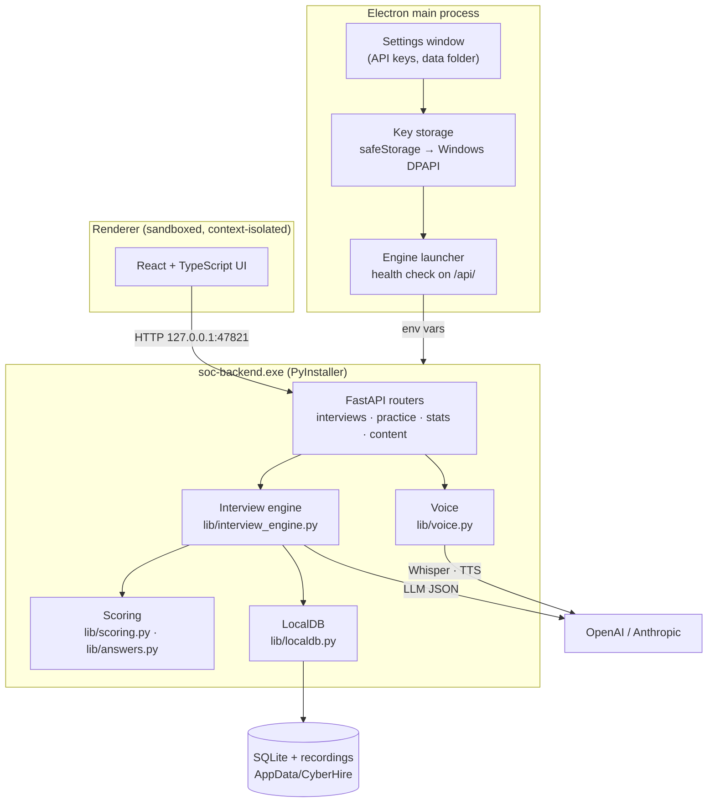
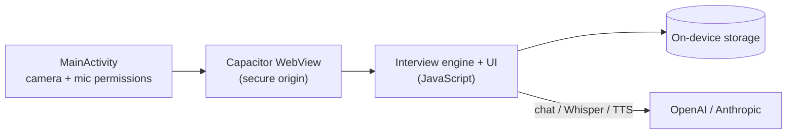

# 01 — Architecture

CyberHire ships as two self-contained apps that share the same interview design, question bank and scoring model. Neither app depends on a CyberHire server: the only network traffic is between the user's device and the AI provider they hold a key for.

## Windows app

| Layer | Responsibility |
|---|---|
| **Electron shell** (`electron/main.js`) | Starts and stops the engine, waits for its health check, stores API keys encrypted with Windows DPAPI, grants camera/mic only to the app window, and provides the Settings window and app menu. |
| **React UI** (`frontend/`) | All screens: dashboard, setup, lobby, interview room, reports, practice, history. Runs in a sandboxed, context-isolated renderer. |
| **FastAPI engine** (`backend/`) | Interview orchestration, scoring, speech processing and persistence, packaged as a single executable with PyInstaller. Bound to `127.0.0.1` only. |
| **LocalDB** (`backend/lib/localdb.py`) | A MongoDB-compatible async API (find, update, aggregate, unique indexes) backed by SQLite, so the original server code runs unchanged without a database install. |

### Porting from the hosted web app

The project started as a hosted web application (FastAPI + MongoDB + a managed LLM key). To make it a standalone desktop app:

- MongoDB was replaced by the embedded `LocalDB` adapter, so the same query code runs locally.
- The managed LLM gateway was replaced with direct OpenAI / Anthropic clients (`lib/llm.py`, `lib/voice.py`) that use the user's own keys.
- Cloud file storage moved to the user's `%APPDATA%\CyberHire` folder.
- Subscription and billing gates were removed; every feature is unlocked.
- Electron replaced the browser, adding OS-level key encryption and media permissions.

## Android app

The Android build packages the interview engine, question bank and interviewer photos into a single APK. It calls the AI providers directly from the device (Anthropic via its browser-access header), records answers with `MediaRecorder`, and detects the end of an answer with a Web Audio RMS voice-activity detector. Layouts adapt from a 412 px phone screen up to an unfolded foldable or tablet.

## Data flow for one answer

1. The interviewer's question is synthesised to speech (`gpt-4o-mini-tts`, falling back to `tts-1`) and played with captions.
2. The microphone records until the candidate has been quiet for ~2.6 seconds, or until they press **Done**.
3. Audio is transcribed with Whisper (`verbose_json`). Segment timings and log-probabilities give pace, long pauses and clarity.
4. The transcript and conversation memory go to the interviewer model, which returns structured JSON: the next action (follow-up, new question, show evidence, close round) and what to say.
5. At the end of each round, answers are batch-scored by the grader prompt; at the end of the interview a hiring decision is generated.
