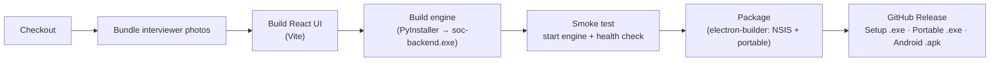
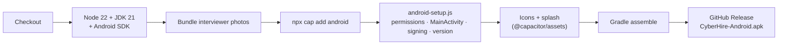

# 06 — Build & Release

Both apps are built in the cloud with GitHub Actions, so no local toolchain is needed to produce a release. Every push to `main` builds the affected app and publishes it on the [Releases](https://github.com/aniknohan/cyberhire-windows-ai-lab/releases) page.

## Windows pipeline (`.github/workflows/build-windows.yml`)



- Runs on `windows-latest` with Node.js 22 and Python 3.12.
- **Smoke test:** the packaged engine is started and must answer its `/api/` health check before the installer is built, so a broken engine never ships.
- Produces `CyberHire-Setup-<version>.exe` (NSIS installer with Start menu and desktop shortcuts) and `CyberHire-Portable-<version>.exe`.
- Android-only changes don't trigger a Windows build (`paths-ignore`).

## Android pipeline (`.github/workflows/build-android.yml`)



- `android-app/scripts/android-setup.js` adds the camera, microphone and audio permissions to the manifest. It also writes a `MainActivity` that asks for those permissions at launch, marks the activity as resizeable (for foldables and tablets), and sets `versionCode` from the CI run number.
- **Signing:** if release-keystore secrets are configured in the repository, the pipeline builds a signed release APK. Otherwise it signs with a fixed key in `android-app/keys/`, so every new build installs over the previous one and keeps the user's data.

## Building locally

**Windows:** install Node.js 22 LTS and Python 3.12, then double-click `build-windows.bat`. The installers appear in `dist/`.

**Android:** install Node.js 22, JDK 21 and the Android SDK, then:

```bash
cd android-app
npm install
node scripts/fetch-portraits.mjs
npx cap add android
node scripts/android-setup.js
npx cap sync android
cd android && ./gradlew assembleDebug
```

## Versioning

- Windows: `version` in the root `package.json` (shown in Settings).
- Android: `version` in `android-app/package.json`, with an automatic build number from CI.
